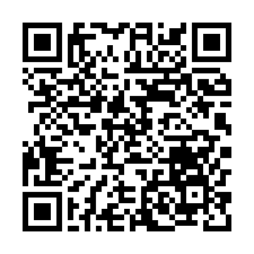
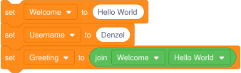

<!-- _paginate: skip -->
<!-- _class: title -->
# Variablen

<!--
Speaker notes:
Einstieg über die Scratch-Analogie: Variablen sind beschriftete Schubladen, in denen Werte liegen.
-->
## Link


## Was sind Variablen?

* Speicherorte mit Namen für Werte
* Können Zahlen, Text, Listen oder Objekte enthalten
* Der Name ist eine textuelle Referenz
* Mit Variablen kann gerechnet werden

<!--
Speaker notes:
Die Formulierung „beschriftete Schublade" bewusst wiederholen – sie taucht in jedem Themenblock wieder auf.
-->

## Zahlen


```python
c = 10
pi = 3.1415
sunUp = True
radius = 10
circumfence = 2*radius*pi
```
<!--
Speaker notes:
Oben Scratch, unten Python – dieselben Konzepte, verschiedene Notation. Auf die Scratch-Bausteine zeigen und das Gegenstück im Code benennen.
-->
## Text

```python
welcome = "Hello World!"
username = "Denzel"
greeting = welcome + " " + username
```
## Lists
```python
cats = ["Lion", "Tiger", "Gepard"]
odd = [1,3,5,7,9]
favorites = [13, Black, "Chocolate"]
```
<!--
Speaker notes:
Listen hier nur kurz zeigen – der eigene Themenblock folgt später. Wichtig ist nur: Eine Variable kann auch mehrere Werte gleichzeitig halten.
-->
## Objects
```python
control = widgets.IntSlider(100)
black = (0,0,0)
titanic = pd.read_csv("data/titanic.csv")
```
<!--
Speaker notes:
Auch Objekte werden später vertieft – hier reicht die Botschaft, dass Variablen beliebige Dinge referenzieren können, sogar ganze Datentabellen.
-->
## Binary
[Binary](https://sethideclercq.com/tools/binaryvisualiser.html)
<!--
Speaker notes:
Kurzer Exkurs, wenn Zeit übrig ist: Der Computer speichert am Ende alles als Nullen und Einsen – das Werkzeug macht das sichtbar.
-->
## Demo & Exercise
### [Scratch Exercise](https://scratch.mit.edu/projects/1086026680/)

* In eigenes Konto remixen (Zuerst anmelden!)
* [Koffein](https://www.eufic.org/en/healthy-living/article/caffeine-levels-in-different-foods-and-drinks) ergänzen für Energy <small>(80 mg)</small> und Limos ("Sodas") <small>(37 mg)</small>
* Beschriften Sie die Symbole (entweder im Hintergrund oder auf der Figur)
* Lassen Sie den Zauberhut folgendes ausgeben:
    * die Menge getrunkenen Wassers <small>(200 ml, 250 ml, 250 ml, 355 ml)</small>
    * die Menge Kalorien <small>(4 kcal, 5 kcal, 105 kcal, 153 kcal)</small>

Bonus: Kosten, Farben der Symbole, Sprachausgabe, Prozent des täglichen Koffeinkonsums, ...


## Demo & Übung
### Python / Jupyter 
[](https://oliverdenzelhfu.github.io/Programming/lite/notebooks/index.html?path=Variables.ipynb) [](https://mybinder.org/v2/gh/OliverDenzelHFU/Programming/main?urlpath=%2Fdoc%2Ftree%2F3-Variables%2FVariables.ipynb)

* Ergänzen Sie Energydrink und Limonade, Wasser und Kalorien
* Formatieren Sie die Ausgabe als Tabelle mit \t (z. B. Kaffee\tTee\tEnergy\tLimo)
* Laden Sie das bearbeitete Notebook herunter

## Bis zum nächsten Mal

[Video](https://www.youtube.com/watch?v=f4KOjWS_KZs)
Wenn Sie noch kein Thema gefunden haben:
Nutzen Sie Mind Mapping zur Themenfindung
[English Article](https://www.mindmapping.com/mind-map)
[Deutscher Artikel](https://www.ideenfindung.de/Mind-Mapping-Kreativitätstechnik-Brainstorming-Ideenfindung.html)
