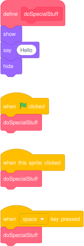

<!-- _paginate: skip -->
<!-- _class: title -->
# Methoden

<!--
Speaker notes:
Methoden sind große Bausteine Ihrer Programme – alles, was Sie bisher geschrieben haben, war Vorbereitung auf dieses Thema.
-->
## Link


## Was ist eine Methode?

> Eine Methode ist eine aufrufbare Einheit von Programmlogik. Sie hat einen Namen, gegebenenfalls Parameter und möglicherweise einen Rückgabewert.

<!--
Speaker notes:
Vergleich zu Mathe oder zu Arbeitsanweisungen.
-->

## Methoden

### Scratch



<!--
Speaker notes:
In Scratch heißen Methoden „eigene Blöcke" – dieselbe Idee, nur mit Klammern statt farbiger Bausteine.
-->

## Methoden

### Python

```python
def fac(x):
    # Fakultät von 0 ist definiert als 1
    if x == 0:
        return 1
    else:
        # Fakultät von x ist x*fac(x-1)
        return fac(x-1)*x

fac(5)
```
<!--
Speaker notes:
An diesem Beispiel beide Konzepte der Sitzung zeigen: Definition mit def und Rückgabe mit return – plus die Rekursion, die gleich folgt.
-->

## Scratch
[Sierpinski](https://scratch.mit.edu/projects/24584643/editor)
[Recursion Tree](https://scratch.mit.edu/projects/10240446/editor)
<!--
Speaker notes:
Zeigen, dass Rekursion visuell sehr gut funktioniert – beide Projekte bauen komplexe Bilder aus sich selbst aufrufenden Blöcken.
-->

## Übung

Taschenrechner für die Fakultät:

1. Eingabe einer Zahl
2. Berechnung der Fakultät in einer Methode (rekursiv)
3. Ausgabe des Ergebnisses

[Was ist die Fakultät?](https://www.youtube.com/watch?v=wfkIiVJ-O50)

<!--
Speaker notes:
Das Video klärt die Mathematik, falls jemand die Fakultät nicht mehr aus der Schule kennt – die Übung selbst ist bewusst klein gehalten.
-->

## Python / Jupyter

[](https://oliverdenzelhfu.github.io/Programming/lite/notebooks/index.html?path=5-Methods%2FMethods.ipynb) [](https://mybinder.org/v2/gh/OliverDenzelHFU/Programming/main?filepath=5-Methods%2FMethods.ipynb)

### Übung

1. Testen Sie die Funktionen abs, ascii, hex, min, max und round (am Punkt „Funktionsaufruf mit Parametern")
2. Erstellen Sie einen [Binder](https://mybinder.org) des Notebooks

## Bis zum nächsten Mal

[Video ansehen](https://www.youtube.com/watch?v=ohCDWZgNIU0)

Entweder

a) Probieren Sie höhere Fakultäten aus
b) Was ist die höchste Fakultät, die Python noch berechnen kann?

<!--
Speaker notes:
Frage b) führt auf die Grenzen von Ganzzahlen und Speicher – ein guter Aufhänger für den Beginn der nächsten Sitzung.
-->